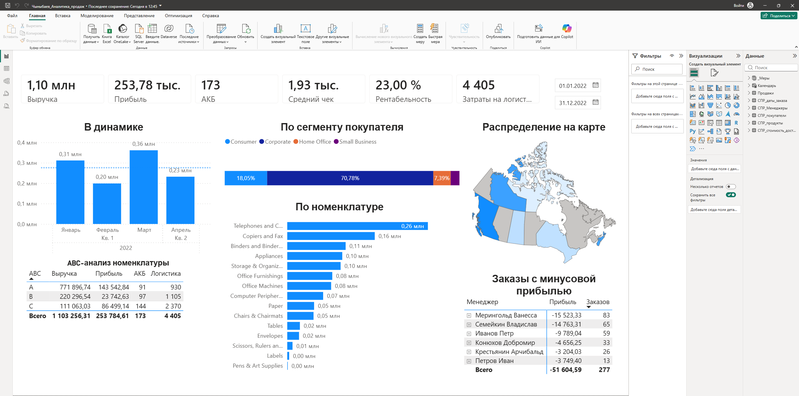
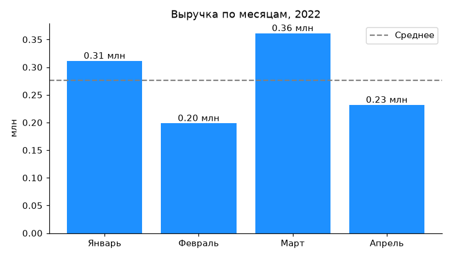
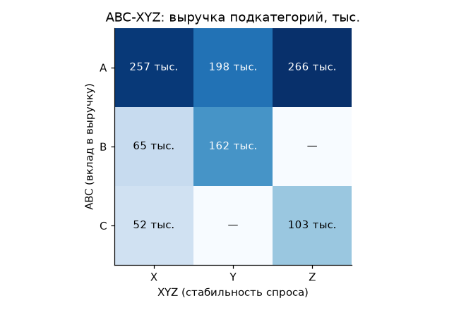
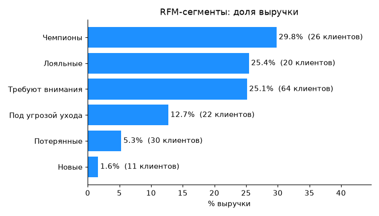
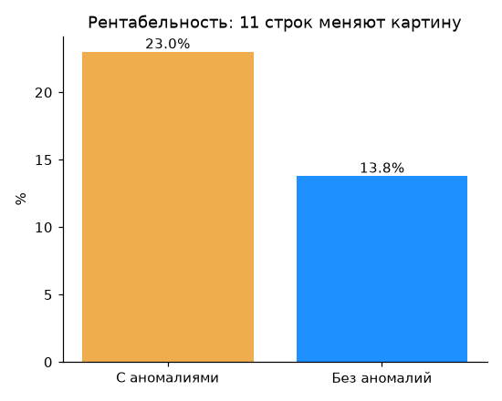
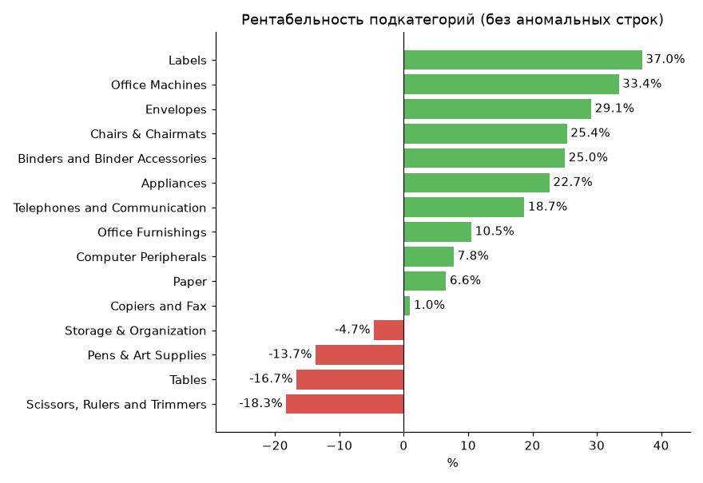

# Sales & Assortment Analysis: Power BI + Python

Sales analytics for an office-supplies business, January–April 2022: key metrics, ABC-XYZ assortment analysis, RFM customer segmentation, subcategory unit economics and a data-quality audit.

The project was built in two independent ways: a **Power BI dashboard** and an **analysis in Python (pandas)**. All core metrics match to the cent, which confirms the calculations are correct.

*Русская версия: [README.ru.md](README.ru.md)*



> The dashboard is built on the raw data, so it shows a 23% margin. Why this number is overstated is explained in "Data Quality Issues" below.

---

## Key Findings

1. **The margin in the raw data is overstated almost twofold.** 11 rows where profit is larger than revenue (for example, revenue 24 and profit 44,689) account for 40% of all profit. Without them the margin is **13.8%, not 23%**. The source of these records should be checked before any decisions are made.
2. **One subcategory carries the business.** Telephones and Communication brings 23% of revenue and has the most stable sales of all (class **AX**).
3. **The main risk area is Copiers and Fax.** It is the second-largest subcategory by revenue (160K), with a margin of only **1%** and the most unstable demand among the leaders (class **AZ**).
4. **Four subcategories are loss-making**, including the large Storage & Organization (97K revenue, **−4.7%** margin). These are candidates for a review of prices and purchasing.
5. **27% of customers bring 55% of revenue** ("Champions" and "Loyal" segments). 22 "At Risk" customers bring 12.7% of revenue and are the first candidates for a win-back campaign.
6. **Almost half of all orders (277 of 571) are loss-making** at the order level, −51.6K in total.

---

## Data

A training dataset of office-supplies sales (regions of Canada): a "Sales" fact table (730 rows) and 5 reference tables: products, customers, managers, order dates and shipping costs.

| Metric | Value |
|---|---|
| Period | 01 Jan 2022 – 29 Apr 2022 |
| Revenue | 1,103,256 |
| Orders | 571 |
| Active customers | 173 |
| Products | 445 |
| Average order value | 1,932 |

---

## What Was Done

### 1. Data Preparation
- Removed empty rows, trimmed spaces, removed duplicates in the reference tables.
- Revenue and profit were stored as text with a **non-breaking space** as the thousands separator; converted to numbers.
- 16 products have purely numeric names (e.g. "688", "3285"), which Excel stores as numbers. Without converting them to text, 23 sales lost their link to the product table.
- Star schema: joins use the `validate="many_to_one"` check so that duplicates in reference tables cannot double the revenue.

### 2. Metrics
Revenue, profit, margin, active customers, average order value, shipping costs, monthly trend, loss-making orders by manager. An order counts as loss-making **as a whole** (total profit across all its lines < 0), not line by line.



### 3. ABC-XYZ Analysis
- **ABC**: contribution to revenue. A is the first 70%, B up to 90%, C the rest.
- **XYZ**: demand stability, measured as the coefficient of variation of monthly revenue. X < 0.3, Y 0.3–0.6, Z > 0.6.

The analysis is done at the **subcategory** level: 251 of 445 products were sold only once, so XYZ at product level carries no information. The XYZ thresholds are higher than the classic ones (10% / 25%) because the period is short, only 4 months.



| | X (stable) | Y (fluctuating) | Z (volatile) |
|---|---|---|---|
| **A** | Telephones | Appliances, Storage | Copiers and Fax, Binders |
| **B** | Computer Peripherals | Office Furnishings, Office Machines | — |
| **C** | Paper, Labels | — | Chairs, Tables, Envelopes, Scissors, Pens |

### 4. RFM Segmentation
Recency is days since the last purchase, Frequency is the number of orders, Monetary is revenue. Each is scored 1–3, and segments are assigned by rules.



| Segment | Customers | Revenue share | Avg. orders | Days since purchase |
|---|---|---|---|---|
| Champions | 26 | 29.8% | 7.1 | 6 |
| Loyal | 20 | 25.4% | 6.3 | 36 |
| Need Attention | 64 | 25.1% | 2.6 | 20 |
| At Risk | 22 | 12.7% | 2.3 | 72 |
| Lost | 30 | 5.3% | 1.0 | 83 |
| New | 11 | 1.6% | 1.0 | 6 |

### 5. Unit Economics and Data Quality



After excluding the anomalous rows:



Another example of how the anomalies distort the picture: on the raw data Express Air looks much more profitable than Regular Air (31% vs 21% margin), but on the cleaned data there is almost no difference (13.5% vs 13.9%).

---

## Data Quality Issues

| Issue | Impact | Solution |
|---|---|---|
| 11 rows where profit is larger than revenue | Margin 23% instead of 13.8% | Flagged and excluded from margin analysis |
| 18 customers recorded with different segments in the customer table | Segment distribution depends on record order | First record kept; needs confirmation from the data owner |
| Non-breaking space in numbers | Numbers read as text | Cleaned before type conversion |
| Numeric product names | 23 sales lost in joins | Column converted to text |

---

## Recommendations

1. Check the source of the 11 anomalous records before using the margin figure in reporting.
2. Review pricing or purchasing terms in the loss-making subcategories, starting with Storage & Organization (class A).
3. For Copiers and Fax (AZ, 1% margin), find the reasons for the low margin and unstable demand before increasing purchases.
4. Launch a win-back campaign for the "At Risk" segment (22 customers, 12.7% of revenue).
5. Review loss-making orders by manager: the top manager has 83 loss-making orders.

---

## Tools

- **Power BI**: Power Query, star schema, custom calendar table, DAX measures, ABC in calculated columns, map, drill-down matrix.
- **Python**: pandas, matplotlib, Jupyter.

## Repository Structure

```
├── data/
│   └── sales_raw.xlsx              raw data
├── notebooks/
│   └── sales_analysis.ipynb        Python analysis
├── powerbi/
│   ├── sales_dashboard.pbix        Power BI dashboard
│   └── screenshots/                dashboard screenshots
├── images/                         charts from the notebook
├── requirements.txt
├── README.md
└── README.ru.md                    Russian version
```

## How to Run

```
pip install -r requirements.txt
jupyter notebook notebooks/sales_analysis.ipynb
```

Dashboard: open `powerbi/sales_dashboard.pbix` in Power BI Desktop. If the data does not refresh, point it to `data/sales_raw.xlsx`: Home → Transform data → Data source settings → Change Source.

## Limitations

- The period is only 4 months, so seasonality cannot be assessed and full cohort analysis is not possible.
- The XYZ and RFM thresholds are tuned to the short period and the small customer base.

---

**Author:** Adilet Chynybaev · GitHub: [adiletchyn-alt](https://github.com/adiletchyn-alt)
